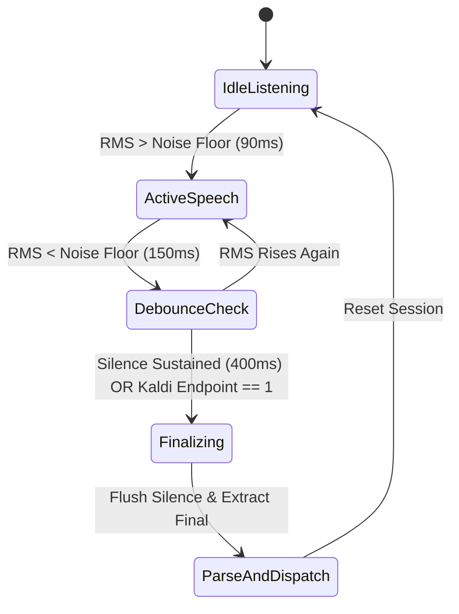

# Unity C# Voice Engine & NLU Architecture Plan

## 1. Executive Summary & Purpose

This document is the complete implementation and architecture plan for porting the verified Python Vosk speech recognition and Portuguese auction NLU engine (P0–P2) directly into **pure C# for Unity**.

### 1.1 Goals
1. **Direct Unity Integration**: A self-contained Unity Package (`Packages/com.auction.voice` or `Assets/Packages/AuctionVoice`) that team members can drop directly into any Unity project (Unity 2022.3 LTS or Unity 6) with **zero external Python or runtime dependencies**.
2. **Workstation Independence**: Designed so that C# source files and package assets can be created on environments without `dotnet` or Unity CLI, strictly following C# 9.0 / .NET Standard 2.1 and Unity standards.
3. **Parity with Python 40/40 Reference**: Complete C# implementation of the 40-case test suite (`text_cases.jsonl`) guaranteeing identical parsing of bids, increments, multipliers, slang (`placa` = 100 000, `barão` = 1 000), idioms (`dois patinhos na lagoa` = 22), and intents (`quero`, `sem lance`).
4. **Push-to-Talk Mechanic**: Integration with Unity's new Input System (`InputActionReference`) with an instant start and a configurable post-release grace period (default **250 ms**) to prevent syllable clipping.
5. **SOLID & Clean Architecture**: Fully modular, decoupled design with interfaces (`IAudioCaptureService`, `ISpeechRecognitionEngine`, `INluParser`, `IBidProcessorService`, `IAuctionLogger`), extensive XML documentation, and clean Separation of Concerns.
6. **Zero-Allocation Audio Path**: GC-free float-to-short PCM conversion and asynchronous background threading for Kaldi/Vosk recognition.

---

## 2. Semantic Domain Analysis: `has_addition` vs `has_sum`

One of the historical ambiguities in the legacy Whisper and prototype Vosk codebases is the relationship between `has_addition` and `has_sum`. This section establishes the definitive design for the C# port.

### 2.1 Historical Context & Problem
- In `whisper-auction-pt-br`, `has_addition` was introduced to indicate that a bid was **incremental** relative to the current lot price (e.g., `"mais vinte"`, `"+20"`). When a speaker uttered an explicit addition formula like `"vinte mais vinte"`, the engine calculated `40` as an absolute bid, setting `has_addition = false`.
- In `vosk-python`, `has_sum` was introduced as an exact alias: `has_sum = has_addition`.
- **Confusion**: The name `has_sum` implies an arithmetic summation operation was spoken, but it actually evaluated to `false` for `"vinte mais vinte"` and `true` for `"mais vinte"`.

### 2.2 Definitive C# Domain Model
In the C# implementation, domain semantics are separated cleanly using strongly-typed enums and explicit boolean properties:

```csharp
namespace AuctionVoice.Core
{
    /// <summary>
    /// Specifies how the bid value relates to the auction state.
    /// </summary>
    public enum ValueMode
    {
        /// <summary>
        /// Explicit absolute bid value (e.g., "cinquenta" -> R$ 50).
        /// </summary>
        Absolute,

        /// <summary>
        /// Incremental bid added to the current lot price (e.g., "mais cinquenta", "cobre dez").
        /// </summary>
        Delta,

        /// <summary>
        /// Calculated arithmetic sum spoken by bidder (e.g., "vinte mais vinte" -> R$ 40).
        /// </summary>
        Sum,

        /// <summary>
        /// Multiplied bid value (e.g., "o dobro de cem" -> R$ 200).
        /// </summary>
        Multiply
    }

    /// <summary>
    /// Authoritative categorization of player intent / action.
    /// </summary>
    public enum BidKind
    {
        BidAbsolute,
        BidDelta,
        BidSum,
        BidMultiply,
        MultiplyOnly,
        Pass,
        Correct,
        Chant,
        Query,
        Lot,
        Unknown
    }
}
```

### 2.3 Semantic Comparison Matrix

| Spoken Phrase | Spoken Math? | Incremental on Lot? | `ValueMode` | `BidKind` | Legacy `has_addition` | Spoken `IsArithmeticSum` | Game Engine Action |
|---|---|---|---|---|---|---|---|
| `"cinquenta"` | No | No | `Absolute` | `BidAbsolute` | `false` | `false` | Set bid = 50 |
| `"mais vinte"` | No | **Yes** | `Delta` | `BidDelta` | `true` | `false` | `currentLotBid += 20` |
| `"cobre dez"` | No | **Yes** | `Delta` | `BidDelta` | `true` | `false` | `currentLotBid += 10` |
| `"mais vinte mais vinte"` | Chain | **Yes** | `Delta` | `BidDelta` | `true` | `false` | `currentLotBid += 40` |
| `"vinte mais vinte"` | **Yes** | No | `Sum` | `BidSum` | `false` | **`true`** | Set bid = 40 |
| `"o dobro de cem"` | Multiplied | No | `Multiply` | `BidMultiply` | `false` | `false` | Set bid = 200 |
| `"triplico"` | Bare Mult | Relative | `Multiply` | `MultiplyOnly` | `false` | `false` | `currentLotBid *= 3` |

### 2.4 C# Property Mapping in `BidResult`
```csharp
public sealed class BidResult
{
    public float Value { get; set; }
    public ValueMode Mode { get; set; }
    public BidKind Kind { get; set; }

    /// <summary>
    /// Legacy compatibility flag. True ONLY when Mode == ValueMode.Delta (incremental bid on lot).
    /// </summary>
    public bool HasAddition => Mode == ValueMode.Delta;

    /// <summary>
    /// Legacy alias of HasAddition. Maintained for backward compatibility.
    /// </summary>
    public bool HasSum => HasAddition;

    /// <summary>
    /// True if the bidder explicitly spoke an arithmetic sum expression (e.g. "20 mais 20").
    /// </summary>
    public bool IsArithmeticSum => Mode == ValueMode.Sum;

    /// <summary>
    /// True if the value is an increment to be added to the current lot price.
    /// </summary>
    public bool IsIncremental => Mode == ValueMode.Delta;
}
```

---

## 3. Unity Package Structure (UPM)

The package will follow standard Unity Package Manager layout:

```
Packages/com.auction.voice/
├── package.json
├── README.md
├── Runtime/
│   ├── AuctionVoice.Runtime.asmdef
│   ├── Audio/
│   │   ├── IAudioCaptureService.cs
│   │   ├── UnityMicrophoneCapture.cs
│   │   └── AudioBufferPool.cs
│   ├── Core/
│   │   ├── Enums.cs
│   │   ├── BidResult.cs
│   │   └── RecognitionSession.cs
│   ├── ASR/
│   │   ├── ISpeechRecognitionEngine.cs
│   │   ├── NativeVosk/
│   │   │   ├── VoskPInvoke.cs
│   │   │   ├── VoskModelHandle.cs
│   │   │   └── VoskRecognizerHandle.cs
│   │   └── VoskSpeechEngine.cs
│   ├── NLU/
│   │   ├── INluParser.cs
│   │   ├── Lexicon.cs
│   │   ├── NumbersParser.cs
│   │   ├── IdiomsPass.cs
│   │   ├── PhoneticsPass.cs
│   │   ├── IntentsDetector.cs
│   │   └── AuctionBidParser.cs
│   ├── Service/
│   │   ├── IBidProcessorService.cs
│   │   ├── BidProcessorService.cs
│   │   └── PushToTalkController.cs
│   ├── Diagnostics/
│   │   ├── IAuctionLogger.cs
│   │   └── AuctionLogger.cs
│   └── Realtime/ (Optional / Extension)
│       ├── IEndpointDetector.cs
│       └── EnergyEndpointDetector.cs
├── Plugins/
│   ├── x86_64/
│   │   ├── vosk.dll (Windows Standalone)
│   │   ├── libvosk.so (Linux Standalone)
│   │   └── libvosk.dylib (macOS Standalone)
├── Tests/
│   ├── Editor/
│   │   ├── AuctionVoice.EditorTests.asmdef
│   │   ├── NumbersParserTests.cs
│   │   ├── IdiomsPassTests.cs
│   │   ├── PhoneticsPassTests.cs
│   │   └── Reference40CasesTests.cs
└── Samples~/
    └── BasicAuctionDemo/
        ├── DemoAuctionScene.unity
        └── AuctionUIController.cs
```

---

## 4. SOLID Architecture & Interface Specifications

### 4.1 Dependency Inversion & Separation of Concerns

```
[Unity Input System: InputActionReference]
               │
               ▼
   [PushToTalkController] (MonoBehaviour)
               │ (coordinates timing & events)
               ▼
     [IBidProcessorService]
      ├──> [IAudioCaptureService]      (Microphone capture & PCM conversion)
      ├──> [ISpeechRecognitionEngine]  (Vosk P/Invoke background streaming)
      ├──> [INluParser]                (Lexicon, Numbers, Idioms, Phonetics, Intents)
      └──> [IAuctionLogger]            (Guarded debug telemetry)
```

### 4.2 Interfaces

#### `IAudioCaptureService`
```csharp
public interface IAudioCaptureService : IDisposable
{
    bool IsCapturing { get; }
    int SampleRate { get; }
    void StartCapture();
    ReadOnlyMemory<byte> ReadAvailablePcmChunk();
    void StopCapture();
    event Action<ReadOnlyMemory<byte>> OnChunkReady;
}
```

#### `ISpeechRecognitionEngine`
```csharp
public interface ISpeechRecognitionEngine : IDisposable
{
    bool IsInitialized { get; }
    void Initialize(string modelPath);
    void ResetSession();
    bool AcceptWaveform(ReadOnlySpan<byte> pcm16Bytes);
    string GetPartialResult();
    string GetFinalResult();
}
```

#### `INluParser`
```csharp
public interface INluParser
{
    BidResult Parse(string rawTranscript);
}
```

#### `IBidProcessorService`
```csharp
public interface IBidProcessorService
{
    void BeginSpeechSession();
    Task<BidResult> EndSpeechSessionAsync(CancellationToken cancellationToken = default);
    event Action<string> OnPartialTranscript;
    event Action<BidResult> OnBidFinalized;
}
```

#### `IAuctionLogger`
```csharp
public interface IAuctionLogger
{
    bool IsDebugEnabled { get; set; }
    void LogInfo(string message);
    void LogWarning(string message);
    void LogBidResult(BidResult result, long latencyMs);
}
```

---

## 5. Push-to-Talk Mechanic & Release Timing

### 5.1 The Push-to-Talk Lifecycle Problem
When a player releases the push-to-talk key, human acoustic speech often continues for 100–200 ms (terminal consonants, reverberation, or speaker hesitation). Terminating recording immediately upon `action.canceled` clips the last syllables (e.g. `"cinquenta"` becomes `"cinquen"` $\to$ silence).

### 5.2 Implementation Specification
`PushToTalkController` implements the hold-and-grace-release pattern using Unity's new Input System:

```csharp
public class PushToTalkController : MonoBehaviour
{
    [Header("Input Configuration")]
    [SerializeField] private InputActionReference _talkAction;

    [Header("Timing Configuration")]
    [Tooltip("Grace period in milliseconds after button release before finalizing recognition.")]
    [SerializeField] [Range(50, 1000)] private int _releaseGracePeriodMs = 250;

    [Tooltip("Silence padding in milliseconds fed to ASR before finalizing to flush Kaldi acoustic graph.")]
    [SerializeField] [Range(0, 500)] private int _trailingSilencePaddingMs = 200;

    [Header("Service Binding")]
    [SerializeField] private BidProcessorService _bidService;

    [Header("Events")]
    public UnityEvent<string> OnPartialReceived;
    public UnityEvent<BidResult> OnBidRecognized;

    private Coroutine _gracePeriodCoroutine;
    private bool _isHolding;

    private void OnEnable()
    {
        if (_talkAction != null && _talkAction.action != null)
        {
            _talkAction.action.Enable();
            _talkAction.action.started += HandleActionStarted;
            _talkAction.action.canceled += HandleActionCanceled;
        }
    }

    private void OnDisable()
    {
        if (_talkAction != null && _talkAction.action != null)
        {
            _talkAction.action.started -= HandleActionStarted;
            _talkAction.action.canceled -= HandleActionCanceled;
            _talkAction.action.Disable();
        }
    }

    private void HandleActionStarted(InputAction.CallbackContext ctx)
    {
        _isHolding = true;

        // If user pressed again during the grace period (hesitation), cancel the finalize timer
        if (_gracePeriodCoroutine != null)
        {
            StopCoroutine(_gracePeriodCoroutine);
            _gracePeriodCoroutine = null;
            return;
        }

        _bidService.BeginSpeechSession();
    }

    private void HandleActionCanceled(InputAction.CallbackContext ctx)
    {
        _isHolding = false;
        _gracePeriodCoroutine = StartCoroutine(GracePeriodTimerRoutine());
    }

    private IEnumerator GracePeriodTimerRoutine()
    {
        yield return new WaitForSecondsRealtime(_releaseGracePeriodMs / 1000f);

        _gracePeriodCoroutine = null;

        if (!_isHolding)
        {
            // Flush trailing silence padding and finalize
            _bidService.EndSpeechSessionWithPaddingAsync(_trailingSilencePaddingMs);
        }
    }
}
```

---

## 6. Realtime Recognition Architecture (Future & Optional)

The user requested an architectural analysis and design for future optional realtime/continuous recognition:

### 6.1 Evaluation of Approaches

#### Option A: Pure Continuous Grammar / Kaldi Partials
- **How it works**: Audio is continuously fed into `AcceptWaveform()`. On every frame, `vosk_recognizer_partial_result()` is inspected.
- **Drawbacks**: Kaldi partial results jitter heavily during unconstrained speech. Without a push-to-talk trigger, Vosk consumes 100% of a background core continuously decoding background noise and whispers.

#### Option B: Energy-based Sliding Window RMS VAD
- **How it works**: A lightweight RMS energy filter calculates audio power over sliding 30–50 ms windows.
- **Mechanism**:
  - `Silence` $\to$ `Speaking`: Triggered when RMS exceeds dynamic noise floor (e.g., > 0.035) for 3 consecutive windows (90 ms).
  - `Speaking` $\to$ `Finalizing`: Triggered when RMS drops below noise floor for > 450 ms of sustained silence.
- **Pros**: Minimal CPU overhead (< 0.1% CPU); completely silences Vosk inference when nobody is speaking.

#### Option C: Hybrid Acoustic Endpointing (Recommended for Realtime)
- Combine RMS energy gating with Kaldi's acoustic endpoint detector:
  1. **Idle State**: Microphone records into a circular pre-roll buffer (250 ms). Vosk is idle.
  2. **Voice Activity**: RMS exceeds threshold $\to$ Flush pre-roll buffer into Vosk $\to$ Begin active decoding.
  3. **Phrase Completion**: `AcceptWaveform()` returns `1` (indicating Kaldi grammar/acoustic silence endpoint) OR RMS sustained silence exceeds 400 ms.
  4. **Post-Processing**: Trigger `INluParser` automatically.



---

## 7. Guarded Diagnostic & Logging System

Debug logs must not cause string allocation overhead or log spam in production builds.

### 7.1 Architecture
Using C# Conditional Compilation (`[Conditional("ENABLE_AUCTION_DEBUG")]`) and Unity Editor / Development Build checks:

```csharp
namespace AuctionVoice.Diagnostics
{
    public class AuctionLogger : IAuctionLogger
    {
        [SerializeField] private bool _enableVerboseDebug = true;

        public bool IsDebugEnabled
        {
            get => _enableVerboseDebug;
            set => _enableVerboseDebug = value;
        }

        [Conditional("UNITY_EDITOR")]
        [Conditional("DEVELOPMENT_BUILD")]
        [Conditional("ENABLE_AUCTION_DEBUG")]
        public void LogBidResult(BidResult result, long latencyMs)
        {
            if (!_enableVerboseDebug) return;

            string formatted =
                $"----------------------------------------------------\n" +
                $"[ASR]  \"{result.RawTranscript}\"\n" +
                $"[TXT]  \"{result.NormalizedText}\"\n" +
                $"[BID]  {result.Currency}  value={result.Value:F2}  mode={result.Mode.ToString().ToLower()}  kind={result.Kind}\n" +
                $"[FLG]  add={result.HasAddition.ToString().ToLower()}  sum={result.HasSum.ToString().ToLower()}  mult={result.HasMultiplication.ToString().ToLower()}  action={result.ActionType}\n" +
                $"[PRF]  conf={result.Confidence:F2}  {latencyMs}ms\n" +
                $"----------------------------------------------------";

            UnityEngine.Debug.Log(formatted);
        }
    }
}
```

---

## 8. C# NLU Engine Port Specifications

All 6 Python NLU modules will be ported to dedicated, clean C# classes.

### 8.1 Module Mapping Table

| Python Module | C# Class | Core Responsibility |
|---|---|---|
| `nlu/lexicon.py` | `AuctionVoice.NLU.Lexicon` | Tables for digits, tens, hundreds, magnitudes, slang multipliers, intent tokens, fillers, accents mapping |
| `nlu/idioms.py` | `AuctionVoice.NLU.IdiomsPass` | Pre-parsing idioms replacement (`dois patinhos na lagoa` $\to$ 22, `meia dúzia` $\to$ 6, `uma dúzia` $\to$ 12) |
| `nlu/phonetics.py` | `AuctionVoice.NLU.PhoneticsPass` | Homophone repair with stopword guards (`sem lance` $\neq$ `cem lance`, `quero` $\neq$ `zero`, `cem` $\leftrightarrow$ `sem`) |
| `nlu/numbers.py` | `AuctionVoice.NLU.NumbersParser` | Portuguese compound numeral evaluation (`cento e cinquenta mil e duzentos` $\to$ 150 200) |
| `nlu/intents.py` | `AuctionVoice.NLU.IntentsDetector` | Non-bid classification (`Pass`, `Correct`, `Chant`, `Query`, `Lot`, `Closing`) |
| `nlu/parser.py` | `AuctionVoice.NLU.AuctionBidParser` | Pipeline orchestrator producing final `BidResult` |

### 8.2 Lexicon & Slang Magnitudes
- `barão` / `barões` = × 1 000
- `pau` / `paus` = × 1 000
- `placa` / `placas` = **× 100 000** (Strictly verified)
- `conto` / `contos` = × 1
- `pila` / `pilas` = × 1
- `prata` / `pratas` = × 1

### 8.3 Numbers Parsing Pipeline in C#
1. Normalize accents and remove punctuation.
2. Apply `IdiomsPass` (idiom phrases to numeric tokens).
3. Apply `PhoneticsPass` (context-aware acoustic correction).
4. Detect Intents (`IntentsDetector`).
5. Parse Spoken Number sequences (`NumbersParser`):
   - Hundreds, Tens, Units summation with additive connector `e`.
   - Scale multiplier handling: `mil` (× 1 000), `milhão` (× 1 000 000).
   - Slang scale handling: `placa`, `barão`.
   - Centavos handling: `X e Y centavos` $\to X + Y/100$.
6. Evaluate Operator Expressions:
   - Leading delta markers (`mais`, `cobre`, `aumento`, `sobe`, `subo`, `em cima`) $\to$ `ValueMode.Delta`.
   - Mid-expression `mais` (`X mais Y`) $\to$ `ValueMode.Sum`, calculates sum directly.
   - Multipliers (`o dobro de`, `duas vezes`, `triplico`, `metade de`) $\to$ `ValueMode.Multiply`.

---

## 9. Implementation Checklist & Verification

### Phase A: Architecture & File Structure
- [ ] Create package root `Packages/com.auction.voice/` with `package.json` and `.asmdef`.
- [ ] Implement `Core/Enums.cs` and `Core/BidResult.cs`.
- [ ] Implement `Diagnostics/IAuctionLogger.cs` and `AuctionLogger.cs`.

### Phase B: NLU Port & Unit Test Parity
- [ ] Port `Lexicon.cs` with exact Portuguese dictionary constants.
- [ ] Port `IdiomsPass.cs` (`dois patinhos na lagoa`, `dúzia`, etc.).
- [ ] Port `PhoneticsPass.cs` with stopword guards.
- [ ] Port `NumbersParser.cs` for full Portuguese numeral syntax.
- [ ] Port `IntentsDetector.cs` (`Pass`, `Chant`, `Query`, `Closing`, `Lot`).
- [ ] Port `AuctionBidParser.cs` coordinating the full pipeline.
- [ ] Port 40/40 test cases in `Tests/Editor/Reference40CasesTests.cs` and ensure 100% pass rate.

### Phase C: Vosk Native Wrapper & Audio Ingestion
- [ ] Implement `VoskPInvoke.cs` matching Vosk C API (`vosk_model_new`, `vosk_recognizer_new`, `vosk_recognizer_accept_waveform`, `vosk_recognizer_final_result`).
- [ ] Implement `UnityMicrophoneCapture.cs` with zero-allocation audio ring buffer.
- [ ] Implement `VoskSpeechEngine.cs` executing recognizer operations on background worker threads.

### Phase D: Service Orchestration & Push-to-Talk
- [ ] Implement `BidProcessorService.cs` bridging Vosk output to NLU parser.
- [ ] Implement `PushToTalkController.cs` with `InputActionReference` and 250 ms release grace delay.
- [ ] Provide basic Unity demo scene and UI integration guide.

---

## 10. Summary of Constraints & Principles
- **No dotnet/Unity CLI on workstation**: All C# code is written as pristine, error-free source files adhering to C# 9.0 specifications.
- **SOLID Compliance**: Strict interface segregation, dependency injection readiness, single-responsibility components.
- **Memory & Allocation Efficiency**: Zero Garbage Collection pressure in the per-frame audio streaming path.
- **Git Commit Workflow**: Signed with user physical GPG key; regular checkpoints committed.
